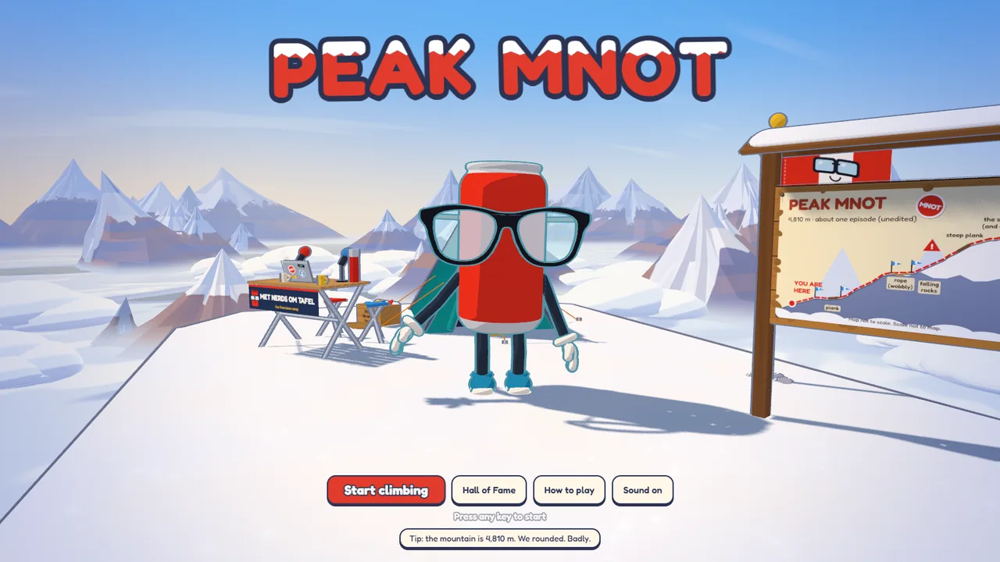
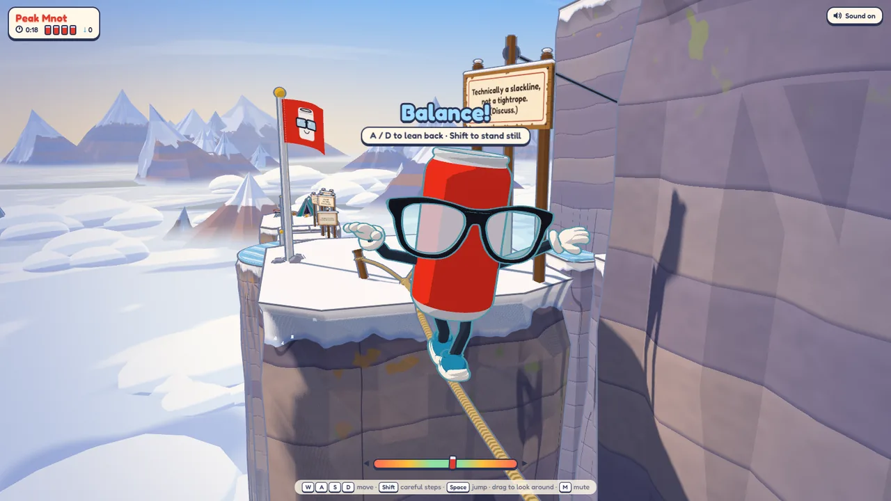
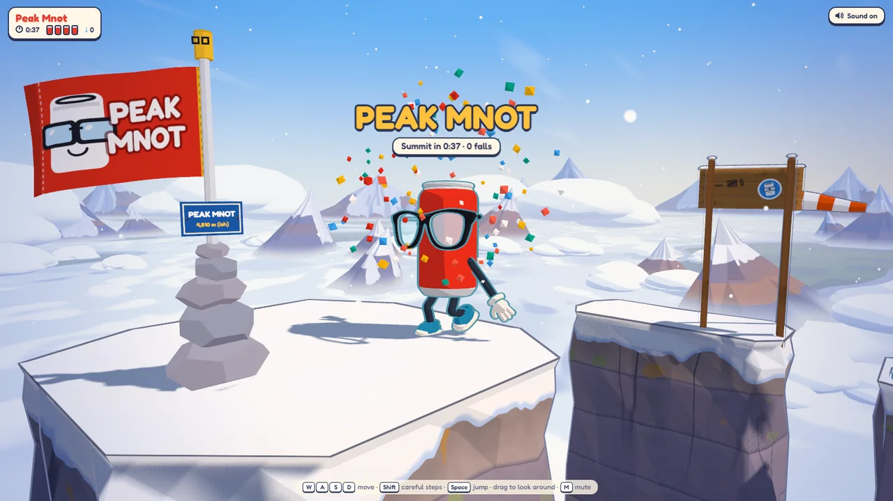

# Peak Mnot

**A soda can with big glasses climbs a mountain. Badly.**



Mnot is the mascot of [Met Nerds om Tafel](https://metnerdsomtafel.nl/), a Dutch podcast about nerd stuff. Among
its listeners, "Peak Mnot" is the moment the nerds dig far too deep into a detail. This game takes that literally:
get Mnot from base camp to the summit (4,810 m, ish) over loose ledges, ice, wind gaps, a gondola, wobbly planks and a
rope, while rocks come down.

The can is the health bar. Every fall or hit dents it, the fourth dent flattens it, and a checkpoint flag pops the
dents back out. The fastest climbs go on the Hall of Fame.

**Play it at <https://peakmnot.mosredna.eu>.**

| | |
|---|---|
|  |  |

## How to play

| Key | |
|---|---|
| WASD / arrows | Move. Right means "onwards" along the route, whatever the camera does |
| Shift | Careful steps: Mnot stops at an edge instead of walking off, and stands still on a plank or rope |
| Space | Jump. A running jump clears about 1 m of gap |
| A / D on a plank or rope | Lean back against the wobble |
| Drag, wheel | Look around and zoom |
| Trackpad: swipe with two fingers, pinch | Look around, zoom |
| M | Sound on/off |

On a phone or tablet: a stick under your left thumb (wherever it lands; a light thumb or small push is careful steps, a
fuller push runs), the round Jump button on the right, drag to look and pinch to zoom.

Loose ledges crumble shortly after you land on them, so don't stop there. On ice Mnot keeps sliding: small taps steer
best. Wind gaps blow on a steady beat, and the windsock tells you when. The full rules are in
[peak/README.md](peak/README.md).

## Run it yourself

You need Python 3 and a browser with WebGL 2. There is no build step and nothing to install: the game is plain
JavaScript modules, and three.js comes from a CDN through an import map.

```bash
python tools/dev_server.py
```

Then open <http://127.0.0.1:5280/peak.html>. The dev server reloads open tabs when a file changes. For the high
scores, start the score server next to it (it listens on port 5281, and the game finds it there):

```bash
python -X utf8 server/peak_scores.py
```

`http://127.0.0.1:5280/` is the animation viewer: Mnot on a turntable, with a button for every clip.

## What's in here

| Path | What |
|---|---|
| [`peak.html`, `peak/`](peak/README.md) | The game: about fifty small ES modules for the route, the physics, the camera, the look, the props and the HUD |
| [`server/`](server/) | The high-score server: Python's standard library and SQLite, and it checks every climb before it counts |
| [`models/`](models/README.md) | Mnot: the model, the rig and fourteen animation clips, built from code in Blender |
| `index.html` | The animation viewer |
| [`sounds.js`, `music.js`, `audio/`](audio/README.md) | Sound effects, and the music, "Pocket Altitude" |
| `tools/` | The dev server, the Blender build script, browser checks and the sound scripts |
| [`IDEAS.md`](IDEAS.md) | Game ideas, for this one and the next |
| [`AGENTS.md`](AGENTS.md) | The house rules for the AI agents that work on this repository |

## How it's made

- **Analytics.** Cookieless Plausible counts public visits and climb milestones. The goals and development exclusions
  are documented in [peak/README.md](peak/README.md#analytics).
- **three.js**, with toon shading and outlines. There's no framework and no bundler.
- **Mnot is built from code.** `tools/build_mnot.py` builds the mesh, the rig, the skin weights and every clip in
  Blender (5.2, in the background). Nobody edits the `.glb` by hand: change the script and rebuild.
- **Small files.** Every module stays under about 400 lines and does one thing, and each folder documents its own.
- **Test bots.** `peak.html?manual` stops the clock, and `peak/dev/bots.js` has test players that balance on beams,
  survey the jumps and climb the whole route. `tools/check_controls.js` runs deterministic browser checks on the
  viewer.
- **AI agents.** Most of it was written by AI coding agents (Claude Code and Codex) working side by side in this
  folder, steered by a human with opinions. [AGENTS.md](AGENTS.md) is how they keep out of each other's way.

## About the high scores

The score server doesn't take the browser's word for anything. The game records each climb, and the server checks
every step against the route and Mnot's physics: standing on rock that is there, never faster than its legs (or the
ice, the wind and the gondola) allow, flying on real parabolas, and reaching every checkpoint. Only then does the
time go on the board.

Yes, you can read the anti-cheat; that's the point. If you find a hole in it, please open an issue rather than
posting 0:01. The server has a few surprises for people who try anyway.

## Contributing

Ideas, bugs and pull requests are welcome.

- **Keep it small.** One idea per pull request. Match the style of the file you're in by hand: no formatter over a
  whole file, and keep each file's line endings (`index.html` and `tools/build_mnot.py` use CRLF, the rest LF).
- **Changing Mnot:** edit `tools/build_mnot.py` and rebuild. See [models/README.md](models/README.md).

  ```bash
  blender --background --factory-startup --python tools/build_mnot.py -- models
  ```

- **Changing the route:** the score server checks climbs against an export of it, so re-export
  `server/route.json` after a change (see `server/README.md`).
- **Before a pull request:** climb the route with `bots.climb` in `peak.html?manual` (see
  [peak/README.md](peak/README.md#testing-by-hand)), and run the score server's tests:

  ```bash
  python -m unittest discover server
  ```

## Credits

- Mnot and the "Peak Mnot" meme come from the [Met Nerds om Tafel](https://metnerdsomtafel.nl/) podcast and its
  listeners.
- Built with [three.js](https://threejs.org) and [Blender](https://www.blender.org). The font is
  [Fredoka](https://fonts.google.com/specimen/Fredoka).
- The sound effects were generated with ElevenLabs. The music was rendered with
  [FluidSynth](https://github.com/FluidSynth/fluidsynth) and S. Christian Collins'
  [GeneralUser GS](https://schristiancollins.com/generaluser.php).

## License

The code is under the [MIT License](LICENSE). Mnot's model, the sounds, the music and the images are under
[CC BY-NC-SA 4.0](LICENSE-ASSETS.md): remix them freely, but not for commercial use. The names "Mnot", "Peak Mnot"
and "Met Nerds om Tafel" belong to the podcast. Fork away, but don't present a fork as the official game.
